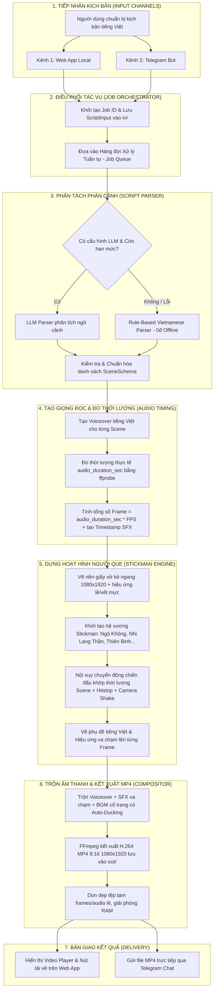

# TÀI LIỆU LUỒNG NGHIỆP VỤ (BUSINESS WORKFLOW)
**Dự án:** Dark Myth Stickman Auto-Studio  
**Phiên bản:** 1.0.0 (Giai đoạn 1 — Project Foundation)  
**Vai trò thiết kế:** Principal Software Architect  

---

## 1. Tổng Quan Luồng Nghiệp Vụ (End-to-End Pipeline Overview)

Luồng nghiệp vụ của **Dark Myth Stickman Auto-Studio** được thiết kế theo nguyên tắc **"Audio-Driven Procedural Animation" (Hoạt hình thủ tục dẫn dắt bởi âm thanh)**. Thay vì vẽ hoạt hình cố định rồi mới ghép tiếng (dễ gây lệch khẩu hình và lệch nhịp chiến đấu), hệ thống luôn **tạo giọng đọc tiếng Việt trước**, đo chính xác thời lượng từng phân cảnh đến từng mili-giây, sau đó mới tính toán số lượng khung hình (`frames = ceil(audio_duration_sec * fps)`) và dàn dựng chuỗi đòn đánh người que khớp hoàn toàn với nhịp đọc và điểm rơi cảm xúc.

---

## 2. Sơ Đồ Luồng Nghiệp Vụ Tổng Thể

### 2.1. Sơ đồ Mermaid (Mermaid Flowchart)



### 2.2. Sơ đồ ASCII (Dành cho Terminal / Text Viewer)

```text
[Người dùng]
     │
     ├──► (Kênh 1: Web App Local :3000) ──┐
     │                                    ▼
     └──► (Kênh 2: Telegram Bot) ────► [ BƯỚC 1: Tiếp nhận & Tạo Job (queued) ]
                                          │
                                          ▼
                                       [ BƯỚC 2: Phân tách kịch bản thành Scenes (parsing) ]
                                          ├─► Ưu tiên: LLM Parser (nếu có key)
                                          └─► Dự phòng 100%: Rule-Based Keyword Parser
                                          │
                                          ▼
                                       [ BƯỚC 3: Tạo Voiceover & Đo thời lượng (generating_audio) ]
                                          ├─► Sinh file thoại tiếng Việt từng cảnh (scene_01.wav...)
                                          └─► Đo chính xác `audio_duration_sec` -> Quy đổi ra số Frame
                                          │
                                          ▼
                                       [ BƯỚC 4: Vẽ Hoạt hình Người Que (rendering_animation) ]
                                          ├─► Vẽ nền giấy vở kẻ ngang 9:16 (1080x1920)
                                          ├─► Tính toán quỹ đạo xương (Kinematics) theo `action_preset`
                                          ├─► Chèn hiệu ứng đòn đánh, tia lửa, Camera Shake, Phụ đề
                                          └─► Xuất điểm mốc thời gian va chạm (`sfx_events`)
                                          │
                                          ▼
                                       [ BƯỚC 5: Trộn Audio & Kết xuất MP4 (compositing) ]
                                          ├─► Mix: Giọng đọc (0dB) + SFX (-3dB) + BGM (-16dB ducking)
                                          ├─► Encode: FFmpeg H.264 MP4 (1080x1920, 30fps, yuv420p)
                                          └─► Xóa thư mục tạm của Job để bảo vệ ổ cứng
                                          │
                                          ▼
                                       [ BƯỚC 6: Trả kết quả (completed / failed) ]
                                          ├─► Web App: Phát trực tiếp & Tải file MP4
                                          └─► Telegram: Upload video MP4 trả về khung chat
```

---

## 3. Mô Tả Chi Tiết Từng Bước Nghiệp Vụ

### Bước 1: Chuẩn bị và đưa kịch bản vào hệ thống (Script Submission)
- **Đầu vào của người dùng:** Người dùng chuẩn bị một đoạn văn bản tiếng Việt dài khoảng **150 – 450 từ** (tương đương 1–3 phút đọc), có thể viết tự nhiên theo từng đoạn xuống dòng hoặc dùng thẻ gợi ý phân cảnh.
  - *Ví dụ:*
    > Cảnh 1: Giữa trang giấy nhuốm máu mực, Tôn Ngộ Không mắt đỏ rực chống Thiết Bảng Như Ý đứng đối diện Nhị Lang Thần.
    > Cảnh 2: Nhị Lang Thần lao tới bổ mạnh Tam Tiêm Đảo xuống! Ngộ Không vung gậy đỡ đòn làm tóe lửa khắp mặt giấy.
    > Cảnh 3: Hàng vạn thiên binh ùa xuống nhưng bị Ngộ Không xoay gậy đánh bay tứ phía, trước khi Bàn tay Phật khổng lồ từ bầu trời giáng xuống!
- **Tiếp nhận:**
  - Trên **Web App**: Người dùng dán kịch bản vào ô soạn thảo, chọn giọng đọc, chọn tốc độ khung hình và nhấn **"Tạo Video"**.
  - Trên **Telegram Bot**: Người dùng gửi lệnh `/render <nội dung kịch bản>` hoặc gửi trực tiếp đoạn văn bản.
- **Khởi tạo tác vụ:** Hệ thống sinh `job_id` duy nhất (ví dụ: `job_20261031_001`), lưu kịch bản gốc vào `in/` và đặt trạng thái `queued`.

### Bước 2: Phân tách kịch bản thành danh sách cảnh (Scene Decomposition)
- Hệ thống chuyển trạng thái sang `parsing`.
- **Cơ chế phân tích kép (Dual-Mode Parser):**
  1. **Tách câu/đoạn:** Chia kịch bản thành các phân cảnh (`SceneSchema`), mỗi cảnh dài trung bình **4 – 10 giây** (khoảng 1–2 câu văn) để đảm bảo nhịp cắt cảnh (pacing) dồn dập chuẩn video ngắn 9:16.
  2. **Trích xuất thuộc tính hình ảnh & hành động:** Từ nội dung câu văn tiếng Việt, bộ phân tích xác định:
     - **Nhân vật xuất hiện (`actors`):** Nhận diện từ khóa (*Ngộ Không / Hầu Vương -> `dark_wukong`*, *Nhị Lang / Dương Tiễn -> `erlang_shen`*, *Thiên binh -> `celestial_army`*, *Phật Tổ / Như Lai -> `buddha_palm`*).
     - **Hành động chiến đấu (`action_preset`):** Nhận diện động từ chiến đấu (*lao tới / xung phong -> `heavy_charge`*, *đỡ đòn / giao binh -> `weapon_clash`*, *xoay gậy / quét sạch -> `staff_vortex`*, *bàn tay giáng xuống -> `giant_palm_slam`*, *đứng đối mặt / gầm thét -> `dark_aura_standoff`*).
     - **Chuyển động máy quay (`camera_movement`):** `zoom_in_fast`, `shake_heavy`, `pan_vertical_up`, `static_wide`.
     - **Trạng thái nền giấy (`background_state`):** `clean_notebook`, `ink_splattered`, `torn_dark_myth`, `heavenly_golden_tint`.

### Bước 3: Tạo giọng đọc tiếng Việt & Đo thời lượng thực tế (Voiceover & Cumulative Timing)
- Hệ thống chuyển trạng thái sang `generating_audio`.
- Với mỗi phân cảnh `scene_id`:
  1. Gửi `narration_text` vào bộ tạo giọng đọc tiếng Việt (`EdgeTTSAudioEngine`) với cấu hình giọng mặc định (`vi-VN-NamMinhNeural` hoặc `vi-VN-HoaiMyNeural`), kèm cơ chế retry/backoff và tự động chuyển giọng nếu node dịch vụ tạm thời quá tải.
  2. Lưu tệp âm thanh tạm vào `out/temp/<job_id>/audio/scene_XX_voice.mp3`.
  3. Dùng `mutagen.mp3.MP3` đo chính xác thời lượng giọng nói thô `raw_voice_sec` (ví dụ: `5.42 giây`).
  4. **Quy chuẩn Đệm Âm Thanh (Audio Padding = 0.30s):** `AudioEngine` là nguồn sự thật duy nhất (Single Source of Truth) thiết lập trường `audio_duration_sec = raw_voice_sec + 0.30`. Khoảng lặng `0.30s` này được nối vào đuôi tệp âm thanh phân cảnh để câu thoại không bị cụt và cho phép động tác nhân vật hoàn tất chu kỳ hồi chiêu (Recovery Frames) trước khi chuyển cảnh.
  5. **Chuẩn hóa Timeline Tránh Lệch Lũy Kế (Cumulative Timeline Framing):**
     Để loại bỏ hoàn toàn sai số làm tròn lũy kế (cumulative rounding drift) giữa các phân cảnh, hệ thống không làm tròn độc lập từng cảnh mà tính toán dựa trên mốc thời gian lũy kế:
     $$T_{\text{start}, i} = \sum_{k=0}^{i-1} \text{Scene}[k].\text{audio\_duration\_sec}$$
     $$T_{\text{end}, i} = T_{\text{start}, i} + \text{Scene}[i].\text{audio\_duration\_sec}$$
     $$\text{Frame}_{\text{start}, i} = \text{round}(T_{\text{start}, i} \times \text{FPS})$$
     $$\text{Frame}_{\text{end}, i} = \text{round}(T_{\text{end}, i} \times \text{FPS})$$
     $$N_{\text{frames}, i} = \text{Frame}_{\text{end}, i} - \text{Frame}_{\text{start}, i}$$
     *Giới hạn sai số:* Do tính chất rời rạc theo khung hình, sai số lượng tử hóa được giới hạn chặt chẽ trong phạm vi $< 0.5$ frame ($< 16.7\text{ms}$ tại 30 FPS) tại mọi ranh giới phân cảnh và triệt tiêu hoàn toàn hiện tượng lệch tiếng trễ hình ở video dài 1–3 phút.
- **Kiểm soát tổng thời lượng:** Tổng thời lượng các cảnh được đối chiếu với cấu hình `target_duration` để khóa bảng thời gian (Timeline Lock) trước khi chuyển sang bước vẽ.

### Bước 4: Vẽ hoạt hình người que khớp thời lượng thoại (Procedural Stickman Rendering)
- Hệ thống chuyển trạng thái sang `rendering_animation`.
- Với từng khung hình $f \in [0, \text{Total Frames} - 1]$ của từng cảnh:
  1. **Lớp 1 — Nền giấy vở (Notebook Paper Layer):** Vẽ trang giấy 1080x1920, đường kẻ ngang xanh, lề đỏ và các vết mực tích lũy từ các đòn đánh trước.
  2. **Lớp 2 — Hiệu ứng môi trường (Atmosphere Layer):** Hắc khí, mây đen, tia chớp hoặc hào quang Phật pháp phía sau.
  3. **Lớp 3 — Nhân vật & Vũ khí (Stickman Kinematics Layer):**
     - Tính toán tiến độ chuẩn hóa $t = f / \text{Total Frames} \in [0.0, 1.0]$.
     - Áp dụng hàm nội suy chuyển động (Easing & Keyframe Pose Interpolation) cho từng khớp xương (Đầu, Cổ, Vai, Khuỷu tay, Bàn tay, Hông, Đầu gối, Bàn chân, Vũ khí).
     - Tại thời điểm va chạm ($t_{\text{impact}}$): Kích hoạt hiệu ứng **Hitstop** (khựng hình 2 frame), vẽ tia lửa va chạm (Clash Sparks), sóng xung kích (Shockwave Ring) và ghi nhận mốc thời gian vào danh sách `sfx_events`.
  4. **Lớp 4 — Máy quay ảo (Virtual 2D Camera):** Áp dụng biến đổi dịch chuyển và phóng đại (`Camera Shake`, `Zoom Punch` vào điểm giao chiến).
  5. **Lớp 5 — Phụ đề tiếng Việt (Typography Layer):** Vẽ câu thoại tiếng Việt ở vùng an toàn (Safe Zone 9:16, cách đáy 280px) với viền tương phản cao dễ đọc trên điện thoại.

### Bước 5: Trộn âm thanh đa lớp & Kết xuất MP4 (Audio Mixing & Video Compositing)
- Hệ thống chuyển trạng thái sang `compositing`.
- **Trộn âm thanh (3-Track Audio Mixer & Gain Staging):**
  1. **Track 1 (Voiceover):** Ghép nối toàn bộ file giọng đọc các cảnh theo đúng thứ tự, chuẩn hóa âm lượng ở mức `0 dBFS` (chuẩn master voice).
  2. **Track 2 (SFX):** Đặt các hiệu ứng âm thanh (tiếng gậy sắt va chạm, tiếng chém gió, tiếng nổ đất đá, tiếng sấm) vào đúng mili-giây `timestamp_ms` đã ghi nhận từ lúc nhân vật va chạm ở Bước 4, cân bằng ở mức `-4.4 dBFS`.
  3. **Track 3 (BGM):** Lặp nhạc nền Hắc Ám Tây Du xuyên suốt tổng thời lượng video, áp dụng bộ lọc giảm âm lượng tự động (**Audio Ducking** xuống `-14 dBFS` khi có giọng đọc thuyết minh, tăng lên `-7 dBFS` ở các nhịp nghỉ giao chiến).
- **Kết xuất Video (FFmpeg Encoding):**
  - Ghép luồng hình ảnh (1080x1920 @ 30fps) và tệp âm thanh tổng hợp (`master_audio.wav`) thành tệp đích `out/<job_id>.mp4` với codec `libx264`, `-pix_fmt yuv420p`, `-movflags +faststart`.
- **Dọn dẹp tệp tạm:** Xóa ngay thư mục `out/temp/<job_id>/` chứa hàng nghìn frame lẻ sau khi file `.mp4` đã được kiểm tra toàn vẹn.

### Bước 6: Bàn giao kết quả cho người dùng (Result Delivery)
- Hệ thống chuyển trạng thái sang `completed` và trả về đối tượng `RenderResult`.
- **Trên Web App Local:** Giao diện tự động cập nhật trình phát video dọc 9:16, hiển thị thông số (thời lượng, độ phân giải, dung lượng file, số phân cảnh) và nút tải xuống `.mp4`.
- **Trên Telegram Bot:** Bot gửi tin nhắn hoàn tất kèm file video `.mp4` trực tiếp vào khung chat của người dùng.

---

## 4. Xử Lý Ngoại Lệ Trong Luồng Nghiệp Vụ (Exception Flows)

| Tình huống lỗi | Cơ chế xử lý tự động (Zero-Crash Policy) |
| :--- | :--- |
| Kịch bản quá ngắn (< 10 từ) hoặc quá dài (> 1000 từ) | Tự động cảnh báo rõ ràng hoặc chia nhỏ/cắt gọn an toàn theo cấu hình giới hạn để không làm tràn RAM. |
| Mất kết nối Internet khi gọi `edge-tts` hoặc LLM | Với LLM: Tự động chuyển sang **Rule-Based Parser** nội bộ.<br>Với Edge-TTS: Thử lại 3 lần với backoff; nếu vẫn thất bại, phát sinh ngoại lệ `AudioGenerationError` rõ ràng và dừng tác vụ với trạng thái `failed`. Tuyệt đối không sinh âm thanh giả. |
| Lỗi thiếu font tiếng Việt trên hệ điều hành | Tự động sử dụng font Unicode tiếng Việt đóng gói sẵn trong `assets/fonts/` hoặc fallback về font hệ thống hỗ trợ UTF-8 (`DejaVu Sans`). |
| Tiến trình FFmpeg bị ngắt giữa chừng | Đánh dấu trạng thái `failed`, ghi rõ nguyên nhân vào `error_message`, và tự động xóa thư mục `out/temp/<job_id>` để tránh rác ổ cứng. |
