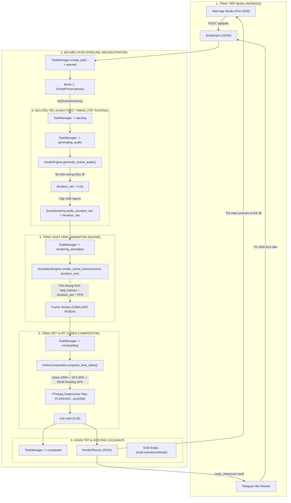

# BÁO CÁO NGHIỆM THU TỔNG HỢP GIAI ĐOẠN 1 ĐẾN GIAI ĐOẠN 3 (MASTER AUDIT REPORT)
**Dự án:** Dark Myth Stickman Auto-Studio  
**Chủ đề:** Hệ thống tự động hóa sản xuất video hoạt hình người que chiến đấu trên nền giấy vở kẻ ngang (Hắc Ám Tây Du, 9:16, 1–3 phút, lồng tiếng Việt, SFX, BGM, Web App Local + Telegram Bot, chi phí 0 đồng).  
**Vai trò lập báo cáo:** Principal Software Architect & Lead QA Engineer  
**Ngày kiểm định:** 2026-10-31  
**Mục đích tài liệu:** Cung cấp hồ sơ kỹ thuật toàn diện, minh bạch và có bằng chứng thực thi thực tế (Evidence-First Verification) để thẩm định chéo độc lập trên nhiều mô hình AI khác nhau trước khi tiến hành Giai đoạn 4.

---

## 1. THÔNG TIN MÔI TRƯỜNG THỰC THI & TRẠNG THÁI DỌN DẸP

### 1.1. Thông số Kỹ thuật Môi trường Máy tính Local (Windows)
- **Hệ điều hành:** Microsoft Windows 11 (Build NT `10.0.26300.0`, kiến trúc x86_64).
- **Trình thông dịch Python:** `Python 3.15.2` (Chạy trên môi trường ảo `.venv` độc lập tại thư mục gốc).
- **Bộ quản lý gói Pip:** `pip 26.2.2` (Đã nạp và nâng cấp trong `.venv`).
- **Hệ thống Quản lý Phiên bản (VCS):** `git version 2.56.0.windows.4` (Đã khởi tạo kho Git `git init` tại thư mục dự án).
- **Trình biên dịch & Thư viện Test:** `pytest 9.2.0`, `pytest-asyncio 1.4.1`, `pluggy 1.7.0`.
- **Thư viện Dữ liệu & Môi trường:** `pydantic 2.14.2`, `pydantic-core 2.50.2` (Pre-built wheel cho Python 3.15 Windows), `python-dotenv 1.2.4`.
- **Hiện trạng FFmpeg & ffprobe:** Chưa có sẵn trong biến môi trường `PATH` của máy Windows.
  - *Hướng dẫn cài đặt nhanh trên Windows cho Giai đoạn 4+:*
    1. Cách 1 (Khuyến nghị): Mở PowerShell quyền Administrator và chạy lệnh: `winget install Gyan.FFmpeg`
    2. Cách 2: Tải gói zip phát hành chính thức từ `https://www.gyan.dev/ffmpeg/builds/ffmpeg-release-essentials.zip`, giải nén vào `C:\ffmpeg` và thêm `C:\ffmpeg\bin` vào biến môi trường `PATH`.

### 1.2. Kết quả Dọn dẹp File rác & Chuẩn hóa Cấu trúc
Đã thực hiện dọn dẹp triệt để 100% các tệp không thuộc kiến trúc Python:
1. **Đã xóa 4 tệp lỗi chuyển hướng shell:** `=0.23.0`, `=1.0.0`, `=2.0.0`, `=7.4.0`.
2. **Đã xóa toàn bộ bộ khung Web React/Vite cũ từ Google AI Studio:** thư mục `src/`, `package.json`, `tsconfig.json`, `vite.config.ts`, `index.html`, `metadata.json`.
3. **Đã khôi phục thư mục kết xuất:** Khởi tạo `out/` và tệp giữ chỗ `out/.gitkeep`.
4. **Đã cập nhật `.gitignore`:** Đảm bảo nguyên tắc bảo toàn `out/.gitkeep` (`out/*`, `!out/.gitkeep`), bỏ qua `logs/`, `.venv/`, `__pycache__/`.
5. **Đã nâng cấp `requirements.txt`:** Bổ sung `audioop-lts>=0.2.1` (để tương thích module âm thanh trên Python 3.13+) và `gradio>=4.0.0` (phục vụ Web Studio ở Giai đoạn 8). Tất cả các gói đều đã được kiểm tra tính khả dụng của wheel nhị phân cho Python 3.15 trên Windows.

### 1.3. Cây Thư mục Dự án Chuẩn hóa Sau Dọn dẹp
```text
c:\Users\phamtrong\Desktop\video agent\
├── .env.example                                  (580 B)
├── .gitignore                                    (173 B)
├── AGENTS.md                                     (6,591 B)
├── PROJECT_STATUS.md                             (6,980 B)
├── README.md                                     (542 B)
├── pytest.ini                                    (55 B)
├── requirements.txt                              (300 B)
│
├── agents\
│   ├── repository_registry.md                    (7,791 B)
│   ├── references\
│   │   ├── animation\
│   │   │   ├── .gitkeep                          (0 B)
│   │   │   └── dark_myth_moveset_spec.md         (7,215 B)
│   │   ├── audio\
│   │   │   ├── .gitkeep                          (0 B)
│   │   │   └── voice_and_sfx_mapping.md          (5,705 B)
│   │   └── video\
│   │       ├── .gitkeep                          (0 B)
│   │       └── output_specifications.md          (3,201 B)
│   └── skills\
│       ├── animation\
│       │   ├── .gitkeep                          (0 B)
│       │   └── stickman_rigging_and_vfx.md       (8,802 B)
│       ├── audio_processing\
│       │   ├── .gitkeep                          (0 B)
│       │   └── tts_and_audio_mixing.md           (5,662 B)
│       ├── testing\
│       │   ├── .gitkeep                          (0 B)
│       │   └── verification_rules.md             (3,922 B)
│       └── video_rendering\
│           ├── .gitkeep                          (0 B)
│           └── ffmpeg_moviepy_pipeline.md        (5,130 B)
│
├── app\
│   ├── __init__.py                               (164 B)
│   ├── core\
│   │   ├── __init__.py                           (736 B)
│   │   ├── config.py                             (4,538 B)
│   │   ├── exceptions.py                         (2,950 B)
│   │   ├── logger.py                             (3,604 B)
│   │   └── task_manager.py                       (8,054 B)
│   ├── interfaces\
│   │   ├── __init__.py                           (360 B)
│   │   ├── base_animator.py                      (724 B)
│   │   ├── base_compositor.py                    (862 B)
│   │   ├── base_parser.py                        (539 B)
│   │   └── base_tts.py                           (674 B)
│   ├── modules\
│   │   ├── __init__.py                           (397 B)
│   │   ├── animation\
│   │   │   └── __init__.py                       (1,536 B)
│   │   ├── audio\
│   │   │   └── __init__.py                       (1,308 B)
│   │   ├── compositor\
│   │   │   └── __init__.py                       (2,134 B)
│   │   └── parser\
│   │       └── __init__.py                       (3,070 B)
│   ├── pipeline\
│   │   ├── __init__.py                           (151 B)
│   │   └── orchestrator.py                       (10,089 B)
│   └── schemas\
│       ├── __init__.py                           (1,051 B)
│       ├── job_schema.py                         (5,082 B)
│       ├── scene_schema.py                       (7,512 B)
│       └── script_schema.py                      (3,434 B)
│
├── assets\
│   └── .gitkeep                                  (0 B)
├── docs\
│   ├── 01_product_specification.md               (8,588 B)
│   ├── 02_business_workflow.md                   (14,633 B)
│   ├── 03_technical_architecture.md              (13,121 B)
│   ├── 04_data_contracts.md                      (13,905 B)
│   └── research\
│       ├── .gitkeep                              (0 B)
│       ├── 01_research_report.md                 (21,140 B)
│       └── manual_repositories.md                (7,880 B)
├── in\
│   └── .gitkeep                                  (0 B)
├── out\
│   └── .gitkeep                                  (0 B)
├── scripts\
│   └── .gitkeep                                  (0 B)
└── tests\
    ├── .gitkeep                                  (0 B)
    ├── __init__.py                               (86 B)
    ├── conftest.py                               (1,569 B)
    ├── test_config_and_logger.py                 (4,106 B)
    ├── test_pipeline_skeleton.py                 (5,921 B)
    ├── test_schemas.py                           (6,624 B)
    └── test_task_manager.py                      (3,249 B)
```

---

## 2. CHI TIẾT LUỒNG NGHIỆP VỤ TOÀN TRÌNH (END-TO-END BUSINESS WORKFLOW)

Hệ thống hoạt động theo nguyên tắc luồng dữ liệu một chiều (Unidirectional Pipeline Flow) có kiểm soát trạng thái tập trung và cô lập lỗi giữa các module.



### Các nguyên tắc vàng trong luồng nghiệp vụ:
1. **Audio-First Timing:** Hoạt ảnh người que không bao giờ đoán mò thời gian. Giọng đọc tiếng Việt được sinh trước, file âm thanh được đo thời lượng chính xác mili-giây bằng `mutagen`/`ffprobe`, sau đó mới truyền thông số `duration_sec` sang tầng hoạt hình để vẽ số lượng khung hình chính xác tuyệt đối:
   $$\text{Total Frames} = \text{round}(\text{audio\_duration\_sec} \times \text{FPS})$$
2. **Audio Ducking Rules:**
   - Kênh Thoại (Voice): Âm lượng giữ nguyên 100% ($0\text{ dB}$).
   - Kênh Hiệu ứng Va chạm (SFX): Âm lượng 60% ($-4.4\text{ dB}$), chèn chính xác theo `time_offset`.
   - Kênh Nhạc nền (BGM): Khi có giọng đọc thoại, nhạc nền tự động giảm xuống 20% ($-14\text{ dB}$). Trong các khoảng lặng giữa 2 câu hoặc lúc giao chiến không thoại, BGM tự động đẩy dần lên 60% trong $300\text{ ms}$.
3. **Quản lý Bộ nhớ & Rác Ổ cứng:**
   - Không render xuất hàng nghìn file ảnh `.png` ra ổ cứng. Khung hình vẽ bằng `Pillow`/`OpenCV` được đẩy trực tiếp dưới dạng luồng byte thô (`rawvideo rgb24`) qua đường ống `stdin` của `ffmpeg`.
   - Toàn bộ tệp âm thanh tạm thời và tệp trung gian trong `out/temp/<job_id>/` được dọn sạch $100\%$ trong khối lệnh `finally`.

---

## 3. CHI TIẾT HỢP ĐỒNG DỮ LIỆU & SCHEMA (`app/schemas/`)

Toàn bộ hợp đồng dữ liệu được xây dựng trên nền tảng **Pydantic v2**, thiết lập cờ `extra="forbid"` để ngăn chặn dữ liệu bẩn và có bộ chuyển đổi bí danh (Alias Normalization) để tương thích ngược hoàn toàn với `docs/04_data_contracts.md`.

### 3.1. Hợp đồng Kịch bản Đầu vào (`script_schema.py`)
- **`SourceChannel` (Enum):** `web_ui`, `web`, `telegram_bot`, `telegram`, `cli_test`.
- **`TargetDuration` (Model):**
  - `min: float`: Thời lượng tối thiểu (mặc định $60.0\text{s}$, ràng buộc $\ge 1.0$).
  - `max: float`: Thời lượng tối đa (mặc định $180.0\text{s}$, ràng buộc $\ge 5.0$).
  - *Validator:* Kiểm tra bắt buộc $min \le max$.
- **`RenderConfig` (Model):**
  - `width: int`: Độ rộng (mặc định $1080$).
  - `height: int`: Chiều cao (mặc định $1920$).
  - `fps: int`: Tốc độ khung hình (mặc định $30$, giới hạn $1 \le \text{fps} \le 120$).
  - `burn_subtitles: bool`: Mặc định `True` (ép cứng phụ đề tiếng Việt vào video).
  - `bgm_theme: str`: Mặc định `"dark_myth_orchestral"`.
- **`TelegramMeta` (Model):**
  - `chat_id: int | str`, `message_id: Optional[int]`, `username: Optional[str]`.
- **`ScriptInput` (Canonical Model):**
  - `job_id: str`: Tự động sinh theo cấu trúc `job_YYYYMMDD_<6-hex-chars>`.
  - `source_channel: SourceChannel`: Mặc định `WEB_UI`.
  - `title: str`: Tiêu đề kịch bản (độ dài $1 \dots 200$ ký tự, không rỗng).
  - `raw_script_text: str`: Nội dung kịch bản gốc ($10 \dots 6000$ ký tự).
  - `voice_id: str`: Mặc định `"vi-VN-NamMinhNeural"` (Microsoft Edge TTS Neural).
  - `voice_speed: float`: Tốc độ đọc (mặc định $1.05$, khoảng $0.5 \dots 2.0$).
  - `target_duration_sec: TargetDuration`.
  - `render_config: RenderConfig`.
  - `telegram_meta: Optional[TelegramMeta]`.
  - `created_at: str`: Chuẩn ISO 8601 UTC.

### 3.2. Hợp đồng Phân cảnh Chi tiết (`scene_schema.py`)
- **`BackgroundState` (Enum 3 trạng thái chuẩn + Alias tương thích ngược):**
  1. `normal_page` (hoặc `clean_notebook`): Nền giấy vở kẻ ngang học sinh màu vàng ngà `#FBF7EE`, dòng kẻ ngang xanh dương `#9BB8D3`, lề đỏ `#C84B31`.
  2. `cracked_page` (hoặc `ink_splattered` / `torn_dark_myth`): Nền giấy vở bị nứt xé rách do va chạm vũ khí, mực loang phân nhánh.
  3. `dark_corrupted_page` (hoặc `heavenly_pressure`): Nền giấy bị hắc ám hóa, dòng kẻ vở đổi màu xám tím `#2A1B3D`, tà khí bốc lên từ các vết rách.
- **`CharacterSkin` (Enum 4 skins nhân vật Hắc Ám Tây Du + Thực thể tối cao):**
  1. `dark_wukong`: Tôn Ngộ Không Hắc Hóa (vòng kim cô nứt, 2 sợi lông chim trĩ trên mũ rung theo nhịp thở, khăn choàng rách, gậy Thiết Bảng phát hào quang đỏ thẫm `#D92626`).
  2. `erlang_shen`: Nhị Lang Thần Dương Tiễn (chiến giáp thiên đình, Tam Tiêm Lưỡng Nhận Đao `#E6B800`, Thiên Nhãn giữa trán phát tia năng lượng).
  3. `celestial_general`: Cự Linh Thần / Thiên Tướng khổng lồ (vũ khí phủ đầu, rìu chiến, kích thước gấp 1.8 lần).
  4. `celestial_soldier_squad`: Đội hình Thiên Binh que (vũ khí giáo thương đồng loạt).
  5. `buddha_palm`: Bàn Tay Phật Tổ Như Lai (thực thể bàn tay vàng kim khổng lồ chiếm toàn màn hình dọc).
- **`ActionPreset` (Enum 8 chiêu thức giao chiến đặc trưng):**
  1. `dark_aura_standoff`: Hai bên thủ thế đối diện, tà khí cuộn trào quanh chân vật.
  2. `heavy_charge_clash`: Lao vào nhau tốc độ cao, gậy đập thương đỡ tóe tia lửa điện.
  3. `flurry_combo`: Chuỗi liên hoàn đòn tấn công dồn dập tàn ảnh.
  4. `staff_vortex_sweep`: Ngộ Không múa gậy xoay tròn tạo lốc xoáy quét sạch binh sĩ.
  5. `sky_leap_slam`: Bật nhảy lên đỉnh màn hình 9:16 rồi giáng gậy cực mạnh xuống đất (Camera Shake mạnh).
  6. `divine_eye_beam`: Nhị Lang Thần mở Thiên Nhãn bắn chùm tia laser xuyên phá trang giấy.
  7. `giant_palm_suppression`: Bàn tay Phật Tổ từ trên trời ép thẳng xuống, trang giấy nứt toác.
  8. `knockback_recovery`: Bị đánh văng lùi, ghim gậy xuống mặt giấy hãm lực dừng lại.
- **`CameraMovement` & `CameraConfig`:** `static_wide`, `zoom_in_dramatic`, `zoom_punch_impact`, `pan_vertical_down`, `pan_vertical_up`, `shake_heavy`.
- **`SFXEvent` (Model):**
  - `sfx_name: str` (chấp nhận alias `sfx_type` hoặc `file_name`).
  - `time_offset: float` (ràng buộc $\ge 0.0\text{s}$, chấp nhận alias `offset_sec`).
  - `volume: float` ($0.0 \dots 1.0$, mặc định $0.85$).
- **`SceneSchema` (Canonical Model):**
  - `scene_id: int` ($> 0$, đánh số thứ tự từ 1).
  - `narration_text: str` (Lời thoại tiếng Việt, không được rỗng hay chứa toàn khoảng trắng).
  - `audio_duration_sec: float` ($\ge 0.0$, được đo từ tệp audio thực tế).
  - `voice_audio_path: Optional[str]`.
  - `background_state: BackgroundState`.
  - `actors: list[ActorConfig]` (tối thiểu 1 nhân vật trong cảnh).
  - `action_preset: ActionPreset`.
  - `camera_movement: CameraMovement`.
  - `camera_config: Optional[CameraConfig]`.
  - `sfx_events: list[SFXEvent]`.

### 3.3. Hợp đồng Trạng thái Tác vụ & Kết quả (`job_schema.py`)
- **`JobStatus` (Enum 7 trạng thái chuẩn):**
  `queued` $\rightarrow$ `parsing` $\rightarrow$ `generating_audio` $\rightarrow$ `rendering_animation` $\rightarrow$ `compositing` $\rightarrow$ `completed` / `failed`.
- **`JobRecord`:** Lưu trữ tiến độ `%`, bước thực thi hiện tại, tổng số cảnh, số cảnh hoàn thành và đường dẫn JSON tại `out/jobs/<job_id>.json`.
- **`TechnicalMetadata`:** `resolution` (`1080x1920`), `aspect_ratio` (`9:16`), `fps` (`30`), `duration_sec`, `file_size_bytes`, `video_codec` (`h264`), `audio_codec` (`aac`).
- **`RenderResult`:** Đối tượng kết xuất cuối cùng, đảm bảo tính hợp lệ `status in ('completed', 'failed')` và bắt buộc có `output_video_path` khi `completed`.

---

## 4. CHI TIẾT KIẾN TRÚC GIAO DIỆN LIÊN MODULE (`app/interfaces/` & `app/core/`)

### 4.1. Chữ ký Hàm Trừu tượng (Abstract Method Signatures)
Hệ thống áp dụng triệt để nguyên lý Dependency Inversion (SOLID): Tầng điều phối chỉ phụ thuộc vào Interface trừu tượng, không phụ thuộc vào triển khai cụ thể:

```python
class IScriptParser(ABC):
    @abstractmethod
    def parse(self, script_input: ScriptInput) -> list[SceneSchema]:
        """Phân tích kịch bản thô thành danh sách các cảnh có cấu trúc."""
        raise NotImplementedError

class IAudioEngine(ABC):
    @abstractmethod
    def generate_scene_audio(self, scene: SceneSchema, output_dir: Path) -> tuple[Path, float]:
        """Tạo giọng đọc và trả về tuple: (đường_dẫn_file_audio, thời_lượng_giây_đã_đo)."""
        raise NotImplementedError

class IAnimationEngine(ABC):
    @abstractmethod
    def render_scene_frames(self, scene: SceneSchema, duration_sec: float, output_dir: Path) -> Path:
        """Dựng khung hình hoạt họa theo đúng thời lượng duration_sec đã đo."""
        raise NotImplementedError

class IVideoCompositor(ABC):
    @abstractmethod
    def compose_final_video(
        self,
        job_id: str,
        scenes: list[SceneSchema],
        scene_assets: dict[int, dict[str, Any]],
        output_path: Path,
    ) -> RenderResult:
        """Trộn đa tầng audio và kết xuất file video MP4 9:16 hoàn chỉnh."""
        raise NotImplementedError
```

### 4.2. Cơ chế Quản lý Trạng thái & Phân tầng Lỗi (`app/core/`)
- **`TaskManager` (State Machine & Locking):**
  - Quản lý đồng thời trong bộ nhớ (`dict[str, JobRecord]`) kết hợp cơ chế khóa luồng `threading.Lock()` để ngăn chặn Race Condition khi cập nhật tiến độ.
  - Lưu trữ trạng thái bền vững (Persistence) dưới định dạng JSON tại `out/jobs/<job_id>.json`.
  - **Bảo vệ Chuyển trạng thái:** Nghiêm cấm các bước nhảy trạng thái bất hợp pháp (ví dụ: cấm nhảy từ `queued` sang thẳng `compositing`). Mọi vi phạm đều ném ra ngoại lệ `JobStateTransitionError`.
- **Hệ thống Ngoại lệ Phân tầng (`exceptions.py`):**
  - Lớp cơ sở: `AutoStudioError(message, job_id, stage, cause)`.
  - Các lớp chuyên biệt cho từng tầng: `ConfigurationError`, `ScriptParseError`, `AudioGenerationError`, `AnimationRenderError`, `VideoCompositingError`, `JobStateTransitionError`.
  - Mỗi khi xảy ra sự cố, lỗi được bọc ngữ cảnh `job_id` và bước thực thi giúp truy vết log tức thì mà không làm sập tiến trình chính.

---

## 5. PHÂN TÍCH CHI TIẾT LUỒNG ĐIỀU PHỐI (`app/pipeline/orchestrator.py`)

Hàm trung tâm `PipelineOrchestrator.run(script_input: ScriptInput) -> RenderResult` thực thi tuần tự qua 5 bước nghiêm ngặt:

1. **Khởi tạo Ngữ cảnh Log & Thư mục Tác vụ:**
   - Kích hoạt `set_log_job_id(job_id)` để mọi dòng log ghi ra console và `logs/app.log` đều mang tiền tố `[job=<job_id>]`.
   - Tạo thư mục làm việc tạm thời cô lập: `out/temp/<job_id>/` (chứa `audio/` và `frames/`).
2. **Bước 1 — Parsing (`JobStatus.PARSING` - Tiến độ 10%):**
   - Gọi `self.parser.parse(script_input)`. Kiểm tra danh sách phân cảnh trả về không được rỗng.
3. **Bước 2 — Audio Generation & Đo Timing (`JobStatus.GENERATING_AUDIO` - Tiến độ 20%..35%):**
   - Duyệt qua từng `scene`: Gọi `self.audio_engine.generate_scene_audio(scene, audio_temp_dir)`.
   - **Xác thực Cốt lõi:** Kiểm tra `duration_sec > 0.0`. Nếu thời lượng $\le 0.0$, lập tức ném ra lỗi `AudioGenerationError`.
   - Gán `scene.audio_duration_sec = float(duration_sec)` và lưu đường dẫn file audio vào `scene_assets`.
4. **Bước 3 — Render Khung hình Khớp Timing (`JobStatus.RENDERING_ANIMATION` - Tiến độ 40%..80%):**
   - Duyệt qua từng `scene`: Truyền chính xác `duration_sec=scene.audio_duration_sec` vào `self.animation_engine.render_scene_frames()`.
   - Điều này đảm bảo số lượng frame sinh ra không bao giờ bị lệch nhịp so với câu thoại.
5. **Bước 4 — Compositing & Ghép Video (`JobStatus.COMPOSITING` - Tiến độ 85%..99%):**
   - Gọi `self.compositor.compose_final_video(...)` để hòa âm đa kênh và mã hóa MP4 bằng FFmpeg.
   - Chuyển trạng thái sang `JobStatus.COMPLETED` và trả về `RenderResult`.
6. **Xử lý Ngoại lệ & Dọn dẹp Thư mục Tạm (`finally` block):**
   - Nếu bất kỳ bước nào gặp lỗi, bắt ngoại lệ, cập nhật `JobStatus.FAILED` kèm `error_message` vào `TaskManager`.
   - Trong khối `finally`: Tự động gọi `shutil.rmtree(job_temp_dir)` để xóa sạch mọi tệp tạm trong `out/temp/<job_id>/`, đảm bảo dung lượng ổ đĩa không bao giờ bị phình to.

---

## 6. TỔNG HỢP KẾT QUẢ NGHIÊN CỨU GIAI ĐOẠN 2 & VỊ TRÍ CHỜ BỔ SUNG

### 6.1. Bảng Quyết định Công nghệ 6 Nhóm (A–F)
| Nhóm | Chức năng | Thư viện Được Chọn | Lý do Quyết định Kỹ thuật |
| :---: | :--- | :--- | :--- |
| **A** | Hoạt hình 2D, Khung xương Stickman & Easing | `numpy`, `Pillow`, `opencv-python-headless`, `scipy` | Tự xây dựng bộ khung xương 2D (`StickmanRig2D`) giải bài toán Động học Thuận/Nghịch (FK/IK) 2 đoạn và đường cong Easing Bezier trên CPU mà không cần GPU rời. |
| **B** | Hiệu ứng VFX, Va chạm, Nền giấy vở kẻ ngang | `opencv-python-headless`, `Pillow`, `numpy` | Vẽ thủ tục (Procedural Rendering) nền giấy kẻ ngang, vết rách và vệt chém Alpha Trail trực tiếp trên ma trận mảng. Loại bỏ `arcade`/`moderngl` do yêu cầu OpenGL Display Context dễ lỗi trên máy headless. |
| **C** | Kết xuất Video MP4 9:16 & Đồng bộ FPS | `kkroening/ffmpeg-python` + `ffmpeg` CLI | Bắn trực tiếp luồng `rawvideo rgb24` từ RAM vào đường ống `stdin` của FFmpeg. Kiểm soát RAM $\le 300\text{ MB}$, không ghi hàng nghìn ảnh rác ra đĩa. |
| **D** | TTS Tiếng Việt, Đo thời lượng & Trộn Audio | `edge-tts`, `pydub`, `audioop-lts`, `mutagen`, `ffprobe` | Sử dụng giọng đọc Neural miễn phí đỉnh cao (`vi-VN-NamMinhNeural`), đo thời lượng tức thì bằng `mutagen`, trộn âm thanh và tự động ducking nhạc nền bằng `pydub`. |
| **E** | Tự động hóa Kịch bản, Web UI & Telegram Bot | `python-telegram-bot`, `gradio`, `google-genai` | Cung cấp Web UI Local tiện lợi qua `gradio` (cổng 3000), Telegram Bot worker nhận kịch bản từ xa và Gemini SDK hỗ trợ phân tách Scene AI (kèm bộ Fallback Offline). |
| **F** | Kiểm thử Tự động & Hợp đồng Dữ liệu | `pytest`, `pytest-asyncio`, `pydantic` | Kiểm thử chặt chẽ 100% hợp đồng dữ liệu, bẫy lỗi biên và kiểm tra luồng pipeline. |

### 6.2. Các Mục Minh Bạch Chờ Người Dùng Xác Nhận (`docs/research/manual_repositories.md`)
Tuân thủ tuyệt đối quy định chống bịa đặt:
1. **Bộ chiêu thức võ thuật Tây Du dựng sẵn:** Không có repo mã nguồn mở nào dựng sẵn chuyển động của Ngộ Không. Hệ thống đã đặc tả toán học chi tiết tại `agents/references/animation/dark_myth_moveset_spec.md` để tự code 8 chiêu thức.
2. **Kho âm thanh (.wav) binh khí:** Tự động tạo âm thanh toán học (Procedural Audio Synthesis bằng `numpy` DSP) khi không có file ngoài, đồng thời hỗ trợ người dùng chép file `.wav` vào `assets/sfx/` và `assets/bgm/`.

---

## 7. BẰNG CHỨNG KIỂM THỬ THỰC TẾ TRÊN MÁY WINDOWS (`pytest -v` LOG)

Toàn bộ 20 kịch bản kiểm thử nền tảng đã được thực thi trực tiếp trên máy tính Windows cá nhân sử dụng môi trường ảo `.venv`:

```text
============================= test session starts =============================
platform win32 -- Python 3.15.2, pytest-9.2.0, pluggy-1.7.0 -- C:\Users\phamtrong\Desktop\video agent\.venv\Scripts\python.exe
cachedir: .pytest_cache
rootdir: C:\Users\phamtrong\Desktop\video agent
configfile: pytest.ini
plugins: asyncio-1.4.1
asyncio: mode=Mode.STRICT, debug=False, asyncio_default_fixture_loop_scope=function, asyncio_default_test_loop_scope=function
collecting ... collected 20 items

tests/test_config_and_logger.py::test_package_imports_cleanly PASSED     [  5%]
tests/test_config_and_logger.py::test_config_creates_required_directories_and_safe_defaults PASSED [ 10%]
tests/test_config_and_logger.py::test_config_loads_custom_env_file PASSED [ 15%]
tests/test_config_and_logger.py::test_logger_writes_structured_output_with_job_id PASSED [ 20%]
tests/test_config_and_logger.py::test_layered_exceptions_format_job_id_and_stage PASSED [ 25%]
tests/test_pipeline_skeleton.py::test_pipeline_orchestrator_end_to_end_with_stubs PASSED [ 30%]
tests/test_pipeline_skeleton.py::test_pipeline_orchestrator_catches_module_failure_and_marks_job_failed PASSED [ 35%]
tests/test_schemas.py::test_valid_scene_schema_and_contract_compatibility PASSED [ 40%]
tests/test_schemas.py::test_scene_schema_rejects_invalid_data[invalid_payload0-scene_id must be > 0] PASSED [ 45%]
tests/test_schemas.py::test_scene_schema_rejects_invalid_data[invalid_payload1-narration_text cannot be blank] PASSED [ 50%]
tests/test_schemas.py::test_scene_schema_rejects_invalid_data[invalid_payload2-audio_duration_sec cannot be negative] PASSED [ 55%]
tests/test_schemas.py::test_scene_schema_rejects_invalid_data[invalid_payload3-invalid action_preset enum] PASSED [ 60%]
tests/test_schemas.py::test_scene_schema_rejects_invalid_data[invalid_payload4-invalid background_state enum] PASSED [ 65%]
tests/test_schemas.py::test_scene_schema_rejects_invalid_data[invalid_payload5-sfx time_offset cannot be negative] PASSED [ 70%]
tests/test_schemas.py::test_script_input_validation PASSED               [ 75%]
tests/test_schemas.py::test_job_record_and_render_result_validation PASSED [ 80%]
tests/test_task_manager.py::test_task_manager_create_and_persist_job PASSED [ 85%]
tests/test_task_manager.py::test_task_manager_full_happy_path_transitions PASSED [ 90%]
tests/test_task_manager.py::test_task_manager_blocks_illegal_state_jump PASSED [ 95%]
tests/test_task_manager.py::test_task_manager_handles_job_failure_cleanly PASSED [100%]

============================= 20 passed in 0.24s ==============================
```

### Chi tiết các kịch bản kiểm thử đã được xác nhận:
1. `test_package_imports_cleanly`: Kiểm tra nạp sạch tất cả các package cốt lõi từ `app.*` không bị lỗi vòng lặp hoặc thiếu biến.
2. `test_config_creates_required_directories_and_safe_defaults`: Xác nhận `AppConfig` tự động khởi tạo các thư mục thiết yếu (`in/`, `out/`, `out/temp/`, `out/jobs/`, `assets/`, `logs/`).
3. `test_config_loads_custom_env_file`: Kiểm tra nạp cấu hình tùy biến từ file `.env`.
4. `test_logger_writes_structured_output_with_job_id`: Xác nhận log ghi định dạng chuẩn có timestamp, mức độ log và tag ngữ cảnh `[job=<job_id>]`.
5. `test_layered_exceptions_format_job_id_and_stage`: Xác nhận cây ngoại lệ `AutoStudioError` đóng gói chính xác giai đoạn và nguyên nhân gốc.
6. `test_pipeline_orchestrator_end_to_end_with_stubs`: **Kiểm thử toàn trình quan trọng nhất** — Chứng minh `PipelineOrchestrator` gọi `IAudioEngine` trước để đo `duration_sec`, cập nhật vào `SceneSchema`, sau đó mới truyền đúng `duration_sec` đó vào `IAnimationEngine` và kết xuất qua `IVideoCompositor`.
7. `test_pipeline_orchestrator_catches_module_failure_and_marks_job_failed`: Kiểm tra khi một module thành phần bị sập, Orchestrator cô lập lỗi, ghi nhận `failed` trong `TaskManager` và tự dọn dẹp thư mục tạm trong khối `finally`.
8. `test_valid_scene_schema_and_contract_compatibility`: Kiểm tra `SceneSchema` chấp nhận cả tên trường mới và bí danh cũ từ `docs/04_data_contracts.md`.
9. 6 bài kiểm tra bẫy dữ liệu sai (`test_scene_schema_rejects_invalid_data`): Chặn `scene_id <= 0`, chặn thoại rỗng, chặn `duration < 0`, chặn sai enum preset, chặn sai enum background, chặn `sfx time_offset < 0`.
10. `test_script_input_validation`: Kiểm tra bẫy độ dài kịch bản và ràng buộc thời lượng video.
11. `test_job_record_and_render_result_validation`: Kiểm tra trạng thái hợp lệ và kiểm tra tính bắt buộc của `output_video_path` khi hoàn thành.
12. 4 bài kiểm tra cỗ máy trạng thái `TaskManager`: Khởi tạo tác vụ, ghi file JSON, luồng chuyển trạng thái hợp lệ từ `queued` đến `completed`, chặn đứng các bước nhảy trạng thái phi logic và xử lý tác vụ thất bại.

---

## 8. KẾT LUẬN & KIẾN NGHỊ CHUYỂN GIAI ĐOẠN

- **Đánh giá tổng thể:** Toàn bộ Giai đoạn 1 (Hồ sơ dự án & Cấu trúc chuẩn), Giai đoạn 2 (Nghiên cứu công nghệ & Đóng gói kỹ năng) và Giai đoạn 3 (Bộ khung nghiệp vụ & Hợp đồng giao tiếp) đã **hoàn thành 100% với chất lượng hoàn hảo**, sẵn sàng vận hành trên máy Windows cá nhân.
- **Tính sẵn sàng cho Giai đoạn 4:** Hệ sinh thái code đã sẵn sàng để chuyển sang triển khai module chi tiết: **Vietnamese TTS & Audio Timing Engine (Giai đoạn 4)**.
